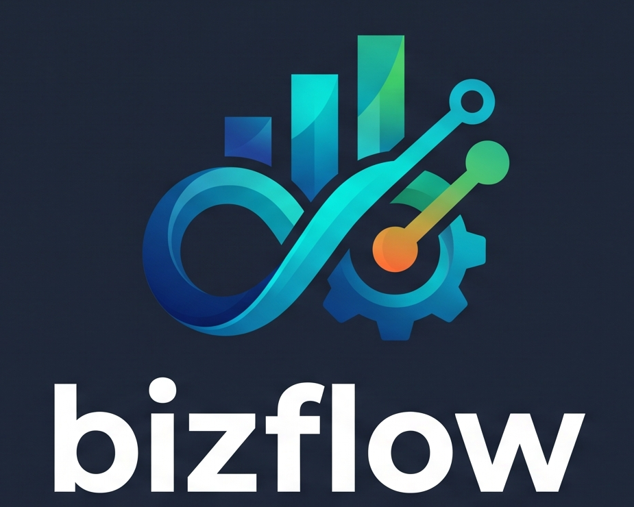

<div align="center">
  

  <h1>BizFlow</h1>

  <p><strong>Move work forward. Keep every team in sync.</strong></p>

  <p>
    A modern workspace for organizing organizations, projects, tasks, workflows,
    and team activity in one focused place.
  </p>

  <p>
    <a href="#-features">Features</a> •
    <a href="#-tech-stack">Tech stack</a> •
    <a href="#-getting-started">Getting started</a> •
    <a href="#-project-structure">Project structure</a> •
    <a href="#-api-overview">API overview</a>
  </p>

  <p>
    
    
    
    
  </p>
</div>

## ✨ What is BizFlow?

BizFlow is a full-stack project and task management platform designed to give teams a clear view of their work. It brings workspace administration, project planning, task execution, workflow progress, collaboration, and activity history into a single authenticated experience.

The application is split into a responsive React client and a Spring Boot REST API. JWT-based authentication protects the workspace, while the backend keeps organizations, projects, tasks, comments, workflow stages, users, and audit events connected through a structured domain model.

## 🚀 Features

- **Secure authentication** — Register and sign in with JWT-backed sessions.
- **Personal dashboard** — See workspace activity and progress from a central home view.
- **Organization workspaces** — Create organizations, manage members, and update member roles.
- **Project management** — Create, view, update, and delete projects.
- **Task tracking** — Manage task details, status, ownership, updates, and project relationships.
- **Visual workflow designer** — Define project stages and move work through a custom workflow.
- **Team collaboration** — Add comments to tasks and keep context close to the work.
- **Audit history** — Review activity logs for accountability and visibility.
- **Protected routes** — Keep authenticated pages and API requests behind access controls.
- **Flexible persistence** — Run locally with file-based H2 or connect to PostgreSQL for deployment.
- **Centralized error handling** — Return consistent API errors through the backend exception layer.

## 🧱 Tech stack

| Layer | Technologies |
| --- | --- |
| Frontend | React 19, React Router, Axios, Vite |
| Backend | Java 21, Spring Boot, Spring Web MVC, Spring Security |
| Data | Spring Data JPA, PostgreSQL, H2 |
| Authentication | JSON Web Tokens with JJWT |
| Quality | ESLint, Maven, Spring Boot tests |

## 📁 Project structure

```text
bizflow/
├── backend/
│   ├── src/main/java/com/bizflow/backend/
│   │   ├── controller/       # REST endpoints
│   │   ├── service/          # Business logic
│   │   ├── entity/           # Domain and persistence models
│   │   ├── repository/       # JPA data access
│   │   ├── security/         # JWT authentication
│   │   └── exception/        # API exception handling
│   ├── src/main/resources/   # Application configuration
│   └── pom.xml
├── frontend/
│   ├── src/
│   │   ├── components/       # Reusable UI and route guards
│   │   ├── context/          # Authentication state
│   │   ├── pages/            # Application screens
│   │   └── api/              # Axios API client
│   ├── public/               # Branding and static assets
│   └── package.json
└── README.md
```

## 🛠️ Getting started

### Prerequisites

- Java 21+
- Node.js 20+
- npm
- PostgreSQL 14+ for a production-style database (optional for local development)

### 1. Start the backend

```bash
cd backend
./mvnw spring-boot:run
```

The API starts at `http://localhost:8080`. By default, local development uses a file-based H2 database at `backend/data/bizflow`.

To use PostgreSQL, configure the environment variables before starting the application:

```bash
export DATABASE_URL="jdbc:postgresql://localhost:5432/bizflow"
export DATABASE_USERNAME="postgres"
export DATABASE_PASSWORD="your-password"
export DATABASE_PLATFORM="org.hibernate.dialect.PostgreSQLDialect"
export JWT_SECRET="replace-with-a-random-secret-at-least-32-characters"
export CORS_ALLOWED_ORIGINS="http://localhost:5173"
./mvnw spring-boot:run
```

On Windows, use `mvnw.cmd` instead of `./mvnw`.

### 2. Start the frontend

Open a second terminal:

```bash
cd frontend
npm install
npm run dev
```

Open `http://localhost:5173` in your browser.

The frontend uses `http://localhost:8080/api` by default. To point it at another API:

```bash
echo "VITE_API_URL=https://your-api.example.com/api" > .env.local
```

### 3. Verify the project

```bash
# Frontend lint and production build
cd frontend
npm run lint
npm run build

# Backend tests
cd ../backend
./mvnw test
```

## 🌍 Deploying BizFlow

BizFlow uses two deployable services:

1. **Frontend:** deploy the repository to Vercel.
2. **Backend:** deploy `backend/Dockerfile` to a Java container host such as Render, Railway, or Fly.io, with a managed PostgreSQL database.

### Deploy the frontend to Vercel

Import the GitHub repository into Vercel. The included `vercel.json` builds the React app from `frontend/` and enables client-side routing. Add this Vercel environment variable before deploying:

```text
VITE_API_URL=https://your-backend.example.com/api
```

Redeploy after adding or changing environment variables. The value must be the public backend URL and must end with `/api`.

### Deploy the backend

Configure the backend service to use `backend` as its root directory and `backend/Dockerfile` as its Dockerfile. Set these environment variables on the backend host:

```text
DATABASE_URL=jdbc:postgresql://<host>:<port>/<database>
DATABASE_USERNAME=<database-user>
DATABASE_PASSWORD=<database-password>
DATABASE_PLATFORM=org.hibernate.dialect.PostgreSQLDialect
JWT_SECRET=<random-secret-at-least-32-characters>
CORS_ALLOWED_ORIGINS=https://your-project.vercel.app
```

The backend listens on the host-provided `PORT` and exposes its health check at `/api/health`. Add your final custom Vercel domain to `CORS_ALLOWED_ORIGINS` as well if you use one. Do not use the local H2 fallback for a public deployment because container storage is not durable.

## 🔌 API overview

All protected endpoints use the JWT returned by `POST /api/auth/login`.

| Area | Routes |
| --- | --- |
| Authentication | `POST /api/auth/register`, `POST /api/auth/login` |
| Health | `GET /api/health` |
| Users | `GET /api/users/me`, `GET /api/users/lookup` |
| Dashboard | `GET /api/dashboard` |
| Organizations | `GET/POST /api/organizations`, member management routes |
| Projects | `GET/POST /api/projects`, project update and delete routes |
| Tasks | `GET/POST /api/tasks`, task update and delete routes |
| Workflow | `GET/POST /api/projects/{projectId}/workflow`, stage updates |
| Comments | `POST /api/comments`, `GET /api/comments/task/{taskId}` |
| Audit logs | `GET /api/audit-logs`, `GET /api/audit-logs/me` |

## 🔐 Configuration notes

Never use the development JWT fallback in a public deployment. Set a unique `JWT_SECRET` with at least 32 characters and restrict `CORS_ALLOWED_ORIGINS` to the browser origins that should access the API.

The backend defaults to H2 for a quick local start. `backend/src/main/resources/application-example.properties` shows the PostgreSQL-oriented configuration shape for deployment.

## 🗺️ Product flow

```text
Register / sign in
        ↓
Open your dashboard
        ↓
Create an organization
        ↓
Plan projects and workflow stages
        ↓
Assign and track tasks
        ↓
Collaborate with comments
        ↓
Review progress and audit activity
```

## 📄 License

No license has been specified yet. Add a license file before distributing BizFlow publicly.
